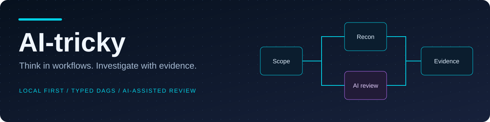
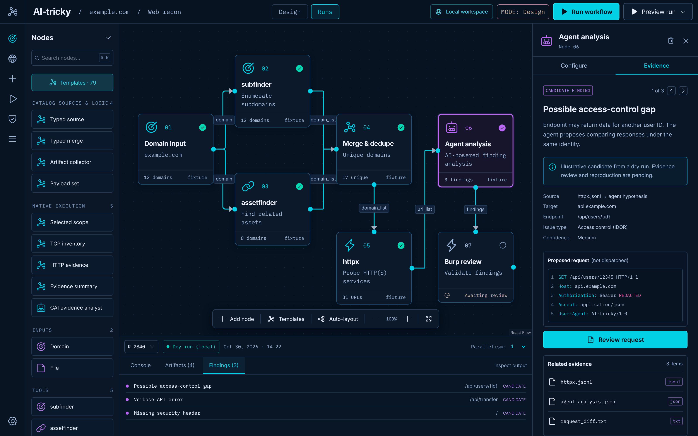
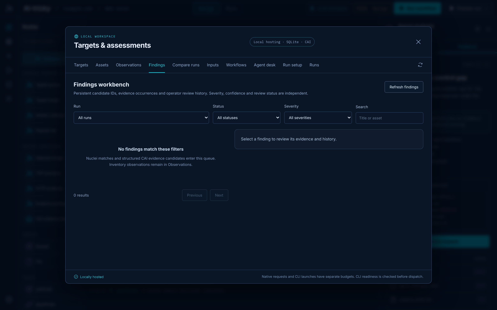
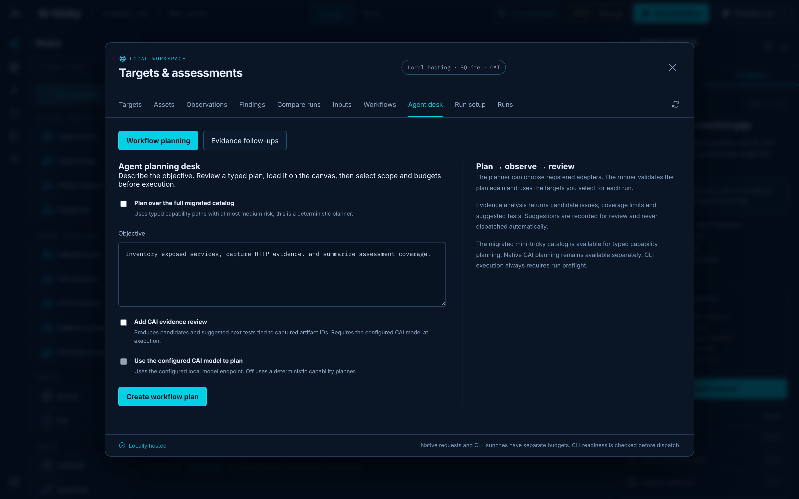
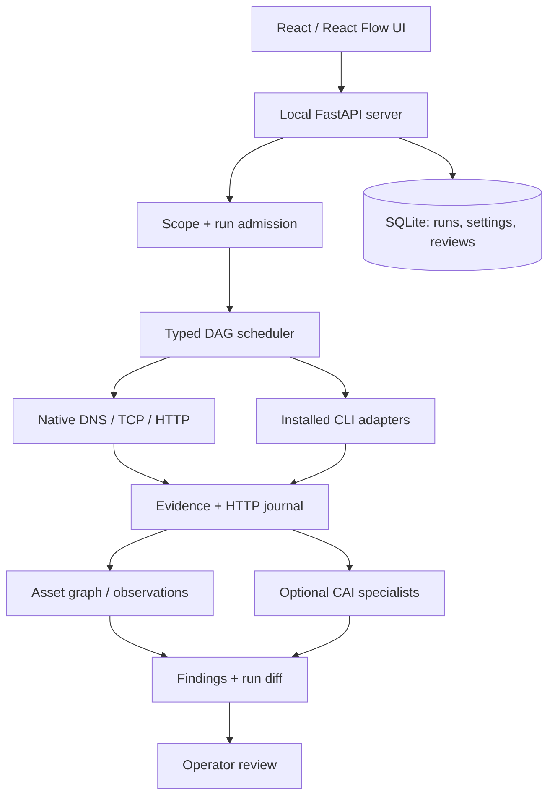

<div align="center">



# AI-tricky
### The local-first, evidence-driven security assessment workbench.

**Visual workflows · Specialist AI agents · Reconnaissance · HTTP evidence · Identity attack-path analysis**

[](https://github.com/MKlolbullen/AI-tricky/actions/workflows/ci.yml)


[](LICENSE)


**[Quick start](#-quick-start) · [Features](#-what-you-can-do) · [Screenshots](#-inside-the-workbench) · [Architecture](#-architecture) · [Limitations](#-current-limitations) · [Roadmap](#-roadmap)**

</div>

---

> [!IMPORTANT]
> **Functional beta, not a magic exploit button.** AI-tricky runs locally and requires explicit authorized scope. AI output is a hypothesis until supported by evidence and reviewed. External CLI tools are installed separately; compatibility depends on installed versions.

## ⚡ Why this exists

Security assessments generate a ridiculous amount of disconnected output. Reconnaissance lives in one terminal, HTTP traffic in another, model suggestions in a chat window, and the evidence you actually need is buried in files.

**AI-tricky connects the pieces without pretending that a model's confidence is proof.**

Design a typed workflow. Execute bounded checks. Preserve the request/response trail. Let specialist agents examine the captured evidence. Compare runs and decide what deserves investigation.

**Local-first means the application, database, workflow engine and evidence store run on your machine.** Targets can be remote systems you are authorized to test. Remote AI inference and passive enrichment are optional, explicitly configured integrations.

## 🧰 What you can do

| Capability | What it does |
|:--|:--|
| 🧩 **Visual workflow studio** | Build typed, directed acyclic graphs with named sockets, registered inputs, preflight checks and per-node artifacts. |
| 🛰️ **Recon & discovery** | Work with domains, IPs, CIDRs and URLs; use native DNS/TCP/HTTP checks and installed CLI adapters. |
| 🌐 **Web reconnaissance** | Explicit wildcard scope, subdomain discovery, probing, crawling and bounded JS/TS/chunk/source-map collection. |
| 🧰 **Trickest open-source pack** | Run pinned mksub and mkpath adapters, or load the local recon and Nuclei workflow. [Setup](docs/TRICKEST-OPEN-SOURCE.md) |
| 🤖 **Specialist agent teams** | Evidence handoffs across recon, analysis, vulnerability review and PoC *planning*, with per-role model routing. |
| 🎛️ **Saved agent presets** | Persist team settings, model choices, worker/turn limits and defaults in local SQLite. |
| 🔌 **Provider choice** | Configure local model endpoints or supported remote providers, including OpenAI, Anthropic, Gemini, xAI and Venice. |
| 🧪 **HTTP evidence journal** | Retain native requests/responses, errors, cancellations, binary captures and HAR exports. |
| 🔍 **Authenticated object access** | Compare two test identities under one reviewed GET profile, with an ownership control and redacted evidence. [Setup](docs/CONTROLLED-VERIFICATION.md#authenticated-object-access) |
| **API Surface** | Search endpoints inferred from saved JS, TypeScript and source maps, with source locations and matching HTTP history. [Usage](docs/API-SURFACE.md) |
| 🟠 **Burp-compatible routing** | Route supported HTTP traffic through a local proxy and import saved Burp XML items. |
| 🕸️ **Asset graph** | Explore typed hosts, services, technologies, files and other entities with provenance and run-to-run diffs. |
| 🛡️ **AD & Entra review** | Scoped identity collection profiles, graph imports and bounded candidate-path analysis; not automated exploitation. |
| 📋 **Findings workbench** | Durable observations, candidate findings, review decisions and comparisons between assessment runs. |
| ⏯️ **Run controls** | Separate native/CLI budgets, deadlines, pause/resume, cancellation and checkpoint-aware recovery. |

**Catalog:** 151 tool contracts, 57 workflows and 141 CLI adapters in the migrated catalog. Ten entries remain context-restricted. Catalog presence **does not** mean an external binary is installed or tested against every upstream version.

## 🖥️ Inside the workbench

<div align="center">


*Workflow studio — visual DAG, node configuration, evidence and execution console.*

</div>

| Run inspection | Findings and evidence |
|:--:|:--:|
|  |  |
| **Run state and history** | **Reviewable findings** |

| Agent workspace | Run comparisons |
|:--:|:--:|
|  |  |
| **Evidence-guided agent proposals** | **What changed between runs?** |

> [!NOTE]
> Some screenshots use fixture/sample data. A simulated canvas preview is not a live assessment result.

## 🚀 Quick start

### Option A — one-command source launcher

**Prerequisites:** Python 3.12, Node.js 20.19+ or 22.12+, npm.

```bash
git clone https://github.com/MKlolbullen/AI-tricky.git
cd AI-tricky
./ai-tricky
```

Open **http://127.0.0.1:8787**. First launch bootstraps the local environment and UI build.

```bash
./ai-tricky --dev       # development / hot reload
./ai-tricky --help      # launcher options
```

### Option B — install with selected external tooling

```bash
./installation.sh --project-only  # app only
./installation.sh --with-cai      # optional separate CAI environment
./start-local.sh
```

For CLI dependencies:

```bash
scripts/install-tools.sh --list
scripts/install-tools.sh --web-recon   # pinned recon starter and Nuclei
scripts/install-tools.sh --trickest-oss # pinned mksub and mkpath
scripts/install-tools.sh --tools=recon,dns
scripts/install-tools.sh --tools=httpx,ffuf
```

Review installation scripts before running them. Some binaries require manual installation; use **Run setup → Check workflow readiness** to see what's actually available.

The pinned web recon profile installs in its own directory and saves per-tool
install diagnostics. See [web recon setup](docs/WEB-RECON.md#pinned-tool-installation)
for the PATH entry, version check and Nuclei template binding.

### Option C — standalone executable

A platform-specific binary can be built with:

```bash
./scripts/build-binary.sh
./dist-bin/ai-tricky
```

The standalone binary bundles the native application, **not** external scanners or the optional CAI SDK. Building requires development dependencies; running the finished binary does not require Python or Node.

### Your first assessment

1. Add your **authorized targets** under **Local workspace → Targets**.
2. Load a native workflow or choose a catalog template.
3. Register required wordlists, resolver lists or templates under **Inputs**.
4. Check adapter readiness, scope and request/CLI budgets.
5. Execute, inspect node artifacts and review the captured evidence.
6. Use **Observations**, **Findings** and **Compare runs** to track results.

## 🧠 Agents: evidence first, confidence second

AI-tricky supports a deterministic team coordinator with specialist roles and bounded evidence handoffs. You can configure **primary**, **complex-task** and **fallback** model routes per role, plus saved local presets and curated model menus.

```text
Authorized scope + explicit budgets
                │
                ▼
         Workflow / Recon
                │
        Captured artifacts
                │
                ▼
       Evidence-bound analysis
                │
                ▼
      Vulnerability candidates
                │
                ▼
       PoC validation plans
                │
                ▼
      Human review / approval
```

The classic five-role CAI analyst team and the staged specialist profile are distinct modes. Agent findings cite supplied captures; PoC plans are **not executed exploits**. Model failures, unavailable providers and incomplete evidence remain visible instead of being silently converted into success.

**Docs:** [Agent settings](docs/AGENT-SETTINGS.md) · [Model routing](docs/TEAM-MODEL-ROUTING.md) · [Team budgets](docs/TEAM-BUDGETS.md) · [Model usage](docs/MODEL-USAGE.md)

## 🔍 Scope is a contract

| Input | Meaning |
|:--|:--|
| `example.com` | Exact host |
| `*.example.com` | Subdomains, **not** the apex |
| `example.com` + `*.example.com` | Apex and subdomains |
| `192.168.1.10` | Exact IP |
| `10.10.0.0/24` | CIDR range, within configured limits |
| `https://app.example.com/api` | Scoped URL origin and path subtree |

Passive discoveries do not automatically authorize active probing. Native HTTP uses destination checks and does not automatically follow redirects. **External CLI processes have different network behavior and are not OS-sandboxed.**

**Docs:** [Web recon](docs/WEB-RECON.md) · [HTTP traffic](docs/HTTP-TRAFFIC.md) · [Identity assessment](docs/IDENTITY-ASSESSMENT.md)

## 🏗️ Architecture



No Docker, Redis or cloud hosting is required. By default the service binds to **127.0.0.1**, and evidence/history are kept under the local data directory.

### Selected configuration

| Variable | Purpose |
|:--|:--|
| `AI_TRICKY_DATA_DIR` | Local database and evidence location |
| `AI_TRICKY_PORT` | Loopback port; default `8787` |
| `CAI_PYTHON` | Optional CAI interpreter |
| `CAI_MODEL_BASE_URL` | Explicit model endpoint |
| `CAI_MODEL` | Model identifier |
| `CAI_ALLOW_REMOTE_MODEL=1` | Permit remote HTTPS model inference |
| `AI_TRICKY_ALLOW_PASSIVE=1` | Enable opt-in passive enrichment |

Never commit credentials. Provider credentials and sensitive captures should remain outside source control.

## 🧪 Development and verification

```bash
python3 -m venv .venv
.venv/bin/python -m pip install -r requirements-dev.txt
npm ci

.venv/bin/python -m pytest backend/tests -q
.venv/bin/python scripts/migrate-catalog.py --check
npm run build
npm test
npm run test:browser
```

The browser suite requires Playwright Chromium installation. CI covers backend contracts, frontend builds and browser fixtures. Recent merged work reports passing automated suites; **this is not a claim of production readiness or successful live-target testing**.

See [validation records](docs/VALIDATION.md) and the [CI workflow](https://github.com/MKlolbullen/AI-tricky/actions/workflows/ci.yml).

## ⚠️ Current limitations

- The platform is a **functional beta**; real-binary compatibility and broader OS validation are incomplete.
- External scanners must be installed independently and may make requests outside native HTTP accounting.
- Burp-compatible proxy routing and saved-items import are supported; **live bidirectional Burp/burpaderp sync is not**.
- AD/Entra paths are candidate relationships requiring validation; no automatic identity exploitation is claimed.
- CAI integration is optional, and model outputs are not independently verified findings.
- The local API is intended for a **single trusted user**, not exposed multi-user hosting.
- The bundled catalog is a set of contracts and templates, not a promise that all 151 tools are runnable.

## 🗺️ Roadmap

- [ ] Validate more external tool versions and operating systems.
- [ ] Expand constrained catalog adapters with explicit account/context contracts.
- [ ] Improve evidence-age rules and controlled replay/recovery.
- [ ] Strengthen identity testing coverage and review workflows.
- [ ] Explore policy-controlled Burp/burpaderp and Strix integration.
- [ ] Refine operator UX, model compatibility checks and agent observability.

## 🤝 Contributing

Issues and pull requests are welcome, especially reproducible bugs, compatibility reports, evidence-handling improvements and scoped workflow templates. Please include the affected platform/tool versions and a minimal, non-sensitive reproduction. Do not submit real credentials or private target evidence.

## 📜 Attribution & license

Created by **[Victor Åhgren / MKlolbullen](https://github.com/MKlolbullen)**.

AI-tricky builds on the MIT-licensed [mini-tricky](https://github.com/MKlolbullen/mini-tricky) catalog. See [third-party notices](THIRD_PARTY_NOTICES.md) for attribution and separate upstream licensing. Application code is [MIT licensed](LICENSE).

**Use only on systems you own or have explicit permission to assess.**

---

<div align="center">

**Less guessing. More evidence. Better security engineering.**

[Repository](https://github.com/MKlolbullen/AI-tricky) · [Issues](https://github.com/MKlolbullen/AI-tricky/issues) · [Pull requests](https://github.com/MKlolbullen/AI-tricky/pulls)

</div>
