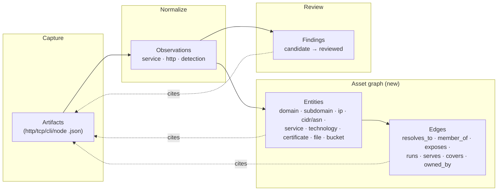

# Evidence asset graph — design

**Status:** draft for review · **Date:** 2026-11-05 · **Author:** (proposed)

Add a **host-centric asset / attack-surface graph** as a new evidence layer:
typed entities (domains, subdomains, IPs, CIDRs/ASNs, services, technologies,
certificates, files, cloud buckets) and the typed relationships between them,
each node and edge **provenance-bound** to the artifact(s) that asserted it. It
sits between normalized observations and reviewable findings, is built
deterministically from captured artifacts, and never auto-confirms anything.

This closes a real gap: today the platform records *what was captured* as a flat
list of per-capture observations; it has no first-class notion of the entities on
a host or the edges between them, so you cannot pivot "show me everything related
to this host."

---

## 1. What "evidence" is today (and the gap)

Three layers exist (see `backend/observations.py`, `backend/evidence.py`,
`backend/store.py`):

1. **Artifacts** — immutable raw captures (`http-N.json`, `tcp-inventory.json`,
   `cli-*.json`, `node-*.json`). A candidate cites these artifact IDs as its
   evidence; `evidence.py` verifies the cited ID is a real capture.
2. **Observations** — normalized, parser-versioned records with `kind`, `asset`,
   `source`, `data`, a `fingerprint` (identity) and `value_hash` (state). Only
   **three kinds** exist: `service` (a TCP port on a host), `http` (an HTTP
   response on a URL, with a few headers + `webserver`/`tech`/`title`), and
   `detection` (a CLI-tool or CAI-model candidate). `canonical_asset()` already
   collapses every asset to a host or IP.
3. **Findings** — reviewable issues (candidate → triaged → verified/rejected/
   resolved) whose operator review state scanner/model output can never
   overwrite.

`/api/assets` is only a thin derived view (entered targets + `http.response`
events → a flat URL/status list). **The gap:** no entities for subdomains, IPs,
CIDRs/ASNs, technologies, certificates, files or buckets as first-class things,
and — most importantly — **no edges** connecting them. Technology today is just
loose fields on an `http` observation. The data often arrives (the catalog tools
`subfinder`/`dnsx`/`httpx`/… flow through `parse_cli`) but lands flat, never
assembled into a connected graph.

---

## 2. The model: a fourth layer

A new **asset graph** layer of typed **entities** and typed **edges**, derived
deterministically from existing artifacts/observations, provenance-bound and
parser-versioned exactly like observations.



### Entities (v1 set)

| Entity | Identity (canonical) | Key data | Source today |
| ------ | -------------------- | -------- | ------------ |
| `domain` | registrable domain | — | scope, subfinder |
| `subdomain` | FQDN | — | subfinder, cert SANs, http host |
| `ip` | normalized IPv4/IPv6 | — | dnsx, `connected_ip` |
| `netblock` | CIDR / ASN | asn, org | passive sources, whois |
| `service` | host + port + transport | state, banner | native TCP, httpx |
| `technology` | normalized product (+version) | categories, version | httpx/`tech`, `webserver`, headers |
| `certificate` | cert SHA-256 | issuer, validity, SANs | TLS capture, cert transparency |
| `file` | host + path | status, content-type, size | http captures, crawling |
| `bucket` | provider + bucket name | provider, exposure | passive/bucket tools |

### Edges (typed, directional)

`subdomain —resolves_to→ ip` · `ip —member_of→ netblock` · `host —exposes→
service` · `host —runs→ technology` · `host —serves→ file` · `certificate
—covers→ subdomain` · `bucket —owned_by→ domain/org`. Each edge carries its
`source`, a `fingerprint` (the triple identity) and the artifact IDs that
asserted it.

### Provenance & versioning

Every entity and edge stores the `artifact_id`(s) it was derived from, the
`source`, and `parser_version` — append-only, re-derivable on parser upgrade, and
never mutating a human decision. An asset the graph stops observing becomes
**"not observed,"** never "removed/resolved," mirroring the run-compare contract
(`evidence.py:absence_means`).

---

## 3. Storage (proposed)

Two new tables alongside `observations`, same provenance/versioning discipline:

```sql
CREATE TABLE assets(
  id TEXT PRIMARY KEY, kind TEXT NOT NULL, identity TEXT NOT NULL,
  canonical TEXT NOT NULL, data TEXT NOT NULL, first_seen TEXT NOT NULL,
  last_seen TEXT NOT NULL, UNIQUE(kind, canonical));
CREATE TABLE asset_edges(
  id TEXT PRIMARY KEY, rel TEXT NOT NULL, src_id TEXT NOT NULL, dst_id TEXT NOT NULL,
  source TEXT NOT NULL, fingerprint TEXT NOT NULL, first_seen TEXT NOT NULL,
  last_seen TEXT NOT NULL, UNIQUE(rel, src_id, dst_id, source));
CREATE TABLE asset_provenance(
  asset_or_edge_id TEXT NOT NULL, artifact_id TEXT NOT NULL, run_id TEXT NOT NULL,
  parser_version TEXT NOT NULL, observed_at TEXT NOT NULL,
  PRIMARY KEY(asset_or_edge_id, artifact_id, parser_version));
```

Built by an `AssetGraph` indexer analogous to `EvidenceIndex.index_pending`:
it reads append-only artifacts, runs typed **extractors** per artifact kind, and
upserts entities/edges with provenance. Reuses `canonical_asset()`,
`digest()`/`encoded()`, `PARSER_VERSION`. Existing databases need no rewrite —
the indexer back-fills lazily like the observation index.

### Extractors (artifact → entities/edges)

- `http-*.json` → `subdomain`(host), `service`(host:port), `technology`(from
  `webserver`/`tech`/`x-powered-by`), `file`(url path), `ip`(`connected_ip`) +
  `resolves_to`, `exposes`, `runs`, `serves` edges.
- `tcp-inventory.json` → `ip`/`subdomain` + `service` + `exposes`.
- `cli-*.json` (subfinder/dnsx/httpx/…) → `subdomain`, `ip`, `resolves_to`,
  `technology`, `service` — reusing/extending `parse_cli`.
- TLS/cert captures → `certificate` + `covers` edges to its SANs.

Deterministic only. The CAI model never asserts graph entities — it reads the
graph as context, exactly as it reads observations.

---

## 4. API (proposed)

- `GET /api/assets/graph?run_id=&kind=&q=&root=&depth=` — entities + edges for a
  scope/host, bounded depth, for the pivot view. Supersedes the thin
  `/api/assets` (kept for compatibility).
- `GET /api/assets/{id}` — one entity with its edges, data and provenance
  (artifact IDs, sources, runs).
- Graph diffing reuses the run-compare pattern: `new` / `changed` / `not_observed`
  per entity and edge between two runs, with the same "absence ≠ resolution"
  warning.

Entities/edges are **observations, not findings**: they never carry review state
and never auto-create a finding. A finding may *reference* assets for context.

---

## 5. UI (proposed)

- An **Asset graph** tab in the Local workspace (sibling to Observations /
  Findings): a host-rooted, pivotable graph/table — pick a host, expand
  `resolves_to` / `exposes` / `runs` / `serves`, filter by entity kind, and open
  any node to see its data + provenance (which capture asserted it, in which run).
- Reuse the existing evidence inspector for provenance; reuse the run-compare
  visual language for graph diffs.
- Canvas tie-in (later): a node that emits the current scope's asset graph as a
  typed stream other adapters can consume.

---

## 6. Invariants preserved (from `AGENTS.md`)

- [x] Deterministic extraction stays distinct from model reasoning — the graph is
      parsed from captures; the model only reads it.
- [x] Observations vs findings stay distinct — assets are observed facts, never
      auto-confirmed; operator review state is untouched.
- [x] Original evidence preserved; parser-versioned, append-only; existing
      databases stay readable and back-fill lazily.
- [x] Absence is "not observed," never automatic resolution.
- [x] Scope boundaries unchanged — the graph only records what scoped captures
      already produced; it initiates no new target traffic.

---

## 7. Phasing

- **v1 — capture-derived graph.** Entities domain/subdomain/ip/netblock/service/
  technology/certificate + the core edges, extracted from native + CLI artifacts.
  New tables, the `AssetGraph` indexer, `GET /api/assets/graph`, and the Asset
  graph tab. File and bucket entities included where native captures already
  supply them (http file paths).
- **v2 — passive-source ingestion.** Optionally ingest Shodan/Censys/etc. (via the
  credential vault) as **provenance-tagged** evidence, clearly sourced and never
  confused with actively captured facts. Adds `bucket` and ASN/whois enrichment.
- **v3 — graph diffing + canvas stream.** Per-entity/edge run comparison and an
  asset-graph canvas node.

---

## 8. Decisions needed before coding

1. **v1 entity set** — confirm domain/subdomain/ip/netblock/service/technology/
   certificate (+ file where native captures supply it); defer bucket to v2?
2. **Capture-only vs passive ingestion in v1** — build purely from captured
   artifacts first (recommended), with passive sources as a labelled v2 layer?
3. **Edge identity granularity** — is an edge unique per `(rel, src, dst, source)`
   (keeps per-source provenance) or collapsed across sources?
4. **`/api/assets` compatibility** — keep the current flat endpoint and add the
   graph alongside (recommended), or redirect it to the graph?
5. **Technology normalization** — a small curated product map, or store raw
   `tech`/`webserver` strings verbatim as the technology identity in v1?
