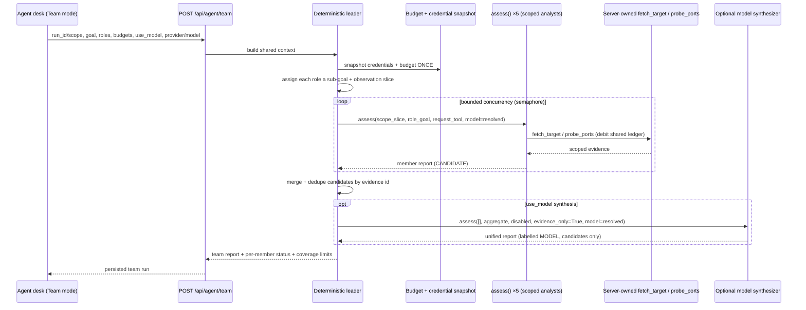

# Multi-agent CAI cooperation — Shape A design

**Status:** draft for review · **Date:** 2026-11-05 · **Author:** (proposed)

A team of **five role-specialized CAI analysts coordinated by one deterministic,
server-owned leader**. The leader is *not* a model: it decomposes the goal,
dispatches scoped analyst runs, enforces one shared budget/credential snapshot,
and aggregates results. A model only reasons *inside* each analyst (and,
optionally, in a final labelled synthesizer pass). This keeps every guarantee in
`AGENTS.md` intact while delivering the "5 + 1 leader cooperating with CAI"
behaviour.

This document covers Shape A only. Shape B (native CAI handoffs with a *model*
leader) is out of scope here and would require relaxing the handoff guard in
`LoopbackModel`.

---

## 1. Why this shape

The current integration (`backend/cai_adapter.py`) runs exactly one agent:

```python
agent = Agent(name='AI-tricky scoped CAI analyst', instructions=instructions,
              model=LoopbackModel(client),
              tools=[...fetch_target, probe_ports...])
result = await Runner.run(agent, input=..., max_turns=12, ...)
```

Two facts drive the design:

1. **All target access is server-mediated.** The agent only has `fetch_target`
   and `probe_ports`, which call back into `request_tool` / `network_tool`
   supplied by `app.py`. No agent touches the network directly.
2. **CAI's native multi-agent is deliberately off.** `LoopbackModel.get_response`
   raises on `output_schema or handoffs`. Shape A **does not change this** — it
   orchestrates *above* the adapter, so the safety boundary is untouched.

Therefore the leader lives in the server/orchestration layer, each team member is
just another `assess()` call with a role-focused instruction, and cooperation
happens through the leader's shared context and aggregation — not through
in-model handoffs.

---

## 2. Roles

One deterministic **Leader** + five **Specialist analysts**. Specialists are a
curated, configurable set; the default five for the web/recon catalog:

| Role key        | Focus                                                        | Tools it may use      |
| --------------- | ------------------------------------------------------------ | --------------------- |
| `surface`       | Exposed services/endpoints, surface map from observations    | fetch_target, probe_ports |
| `transport`     | TLS posture, security headers, cookie flags                  | fetch_target          |
| `authz`         | Auth/session flows, access-control signals (read-only)       | fetch_target          |
| `injection`     | Parameter/reflection/injection *candidate* surfaces          | fetch_target          |
| `logic`         | Business-logic flaws, verbose errors, exposed misconfig      | fetch_target          |

Each specialist keeps the **full safety preamble** (explicit scope only,
read-only, treat responses as untrusted evidence, no credential requests, no tool
creation, no scope expansion, candidates-not-confirmed). The role string only
*appends* a focus; it never replaces the preamble.

---

## 3. Orchestration flow



**Leader responsibilities (all deterministic):**

1. Build a shared context from entered scope and/or selected `observation_ids`.
2. Snapshot credentials and budget **once** for the whole team (see §5).
3. Assign each enabled role a sub-goal and a relevant slice of scope/observations.
4. Dispatch member `assess()` calls with **bounded concurrency** (semaphore,
   default 2–3), each with its own timeout.
5. Debit a **shared budget ledger** as members consume native ops; cap or skip a
   member that would exceed the remaining ceiling (see §5).
6. Aggregate: concatenate observations, **merge candidates keyed by evidence id**,
   collect coverage limits, record per-member status (ok / capped / failed /
   timed-out).
7. Optionally run a final **model synthesizer** (`evidence_only=True`) over the
   aggregate to produce one unified narrative — explicitly labelled as model
   output, candidates only, never auto-confirming anything.

---

## 4. API surface (proposed)

```
POST /api/agent/team
```

Request (mirrors `PlanInput` / `EvidencePlanInput` conventions):

```jsonc
{
  "run_id": "…",                 // optional: source recorded run for observations
  "observation_ids": ["…"],      // optional: evidence slice to share
  "targets": ["example.com"],    // optional: entered scope (one of targets/run_id)
  "goal": "Assess exposed surface and transport posture.",
  "roles": ["surface","transport","authz","injection","logic"],  // subset allowed
  "max_risk": "low",             // passive | low | medium
  "use_model": true,             // per-member model reasoning
  "provider": "openai",          // reuses the model-provider selector
  "model": "gpt-4o-mini",        // operator-supplied remote model name
  "synthesize": true,            // run the final labelled model synthesizer
  "team_budget": { "native_ops": 120, "model_turns": 48 }  // team ceiling
}
```

Response:

```jsonc
{
  "id": "team_…",
  "planner": "deterministic-team-leader",
  "model_called": true,
  "members": [
    { "role": "surface", "status": "ok", "report": "…", "candidates": [...],
      "native_ops": 22, "model_turns": 9 },
    { "role": "injection", "status": "capped", "reason": "team budget ceiling reached" }
  ],
  "candidates": [ /* merged, keyed by evidence id */ ],
  "coverage_limits": [ "logic role skipped: ceiling reached", ... ],
  "synthesis": { "summary": "…", "label": "CAI MODEL SYNTHESIS · CANDIDATES" }
}
```

Gating reuses `resolve_model` exactly as Agent desk and Evidence follow-ups do:
remote provider resolves only with a stored key **and** remote model use enabled,
else 409/422 before any model work. Deterministic team runs (`use_model: false`)
need no provider.

---

## 5. Budgets, credentials, evidence

These are the parts that need the most care — a 5-way fan-out multiplies cost.

- **One credential snapshot** is taken at team start and shared by every member,
  so a concurrent settings change cannot mix identities mid-team (same guarantee
  as a single run today).
- **Shared budget ledger with a team ceiling.** Each member's `fetch_target` /
  `probe_ports` calls debit a single team-wide native-op counter; model turns are
  bounded per member (`max_turns`) **and** by a team `model_turns` ceiling. When
  the remaining ceiling can't cover a member, the leader **caps or skips** it and
  records a coverage limit — it never silently overruns. Native vs CLI accounting
  stays separate, as today (the CAI analyst uses only native tools, so CLI budget
  is untouched).
- **Evidence provenance per member.** Recommended: each member is its own
  `assess()` run and the team record *aggregates* references, preserving which
  role produced which observation/candidate. Original evidence is never
  overwritten; the synthesizer output is stored separately and labelled.

---

## 6. Concurrency, isolation, failure

- **Parallelism:** `asyncio.gather` under a semaphore (default 2–3 concurrent) to
  bound model/endpoint load. Each member has its own timeout.
- **Isolation:** in-process by default; if `CAI_PYTHON` is set, each member runs
  through the existing `assess_worker` path (separate interpreter/process) with no
  extra work — isolation is already supported.
- **Partial results:** a member that fails or times out is marked accordingly; the
  team continues and the aggregate records the coverage gap. A team run is never
  "all or nothing".

---

## 7. Minimal code touch-points

- `backend/cai_adapter.py` — add an optional `role_instructions` (or `persona`)
  parameter to `assess` / `assess_local` / `assess_worker` that **appends** a role
  focus after the fixed safety preamble. No change to the tool set, the loopback
  model, or the handoff guard.
- `backend/` new module `team.py` — the deterministic leader: context build, role
  assignment, shared ledger, bounded-concurrency dispatch, aggregation, optional
  synthesizer. Reuses `resolve_model`, the credential snapshot, `Store`, and the
  existing budget accounting.
- `backend/app.py` — `TeamPlanInput` model + `POST /api/agent/team`; reuse the
  `resolve_model` gate and the `RequestValidationError` handler.
- `src/` — a **Team** mode in Agent desk (sibling to Workflow / Evidence),
  reusing the model-provider selector, with role toggles and a budget-ceiling
  field; renders per-member status + the merged candidate list.
- Tests — role-instruction append preserves the preamble; gating parity with the
  other model paths; budget ceiling caps/skips correctly; partial-failure
  aggregation; credential-snapshot sharing.

---

## 8. Invariant checklist (from `AGENTS.md`)

- [x] Deterministic planning distinct from model reasoning — the **leader is
      deterministic**; the model only reasons inside members and the labelled
      synthesizer.
- [x] Scope, risk and adapter validation independent of model output — unchanged;
      enforced server-side before and around every member.
- [x] Server-owned actions, no scope expansion, no tool creation — every member
      uses the same `fetch_target` / `probe_ports` callbacks.
- [x] Per-run credential snapshot — one shared snapshot per team run.
- [x] Native/CLI budget separation preserved; team ceiling added on top.
- [x] Captured observations vs proposed tests stay distinct; evidence never
      overwritten; model synthesis is candidates-only and never auto-confirms.
- [x] Remote inference stays opt-in and gated via `resolve_model` /
      `model_base_url`; platform hosting stays local.

---

## 9. Phasing

- **v1 — deterministic team, no synthesizer.** Leader + fixed 5 roles, bounded
  parallel fan-out, shared ledger + credential snapshot, aggregate by evidence id.
  New endpoint + minimal Team UI. Everything else reused.
- **v2 — labelled model synthesizer.** Final `evidence_only` pass producing one
  unified report, clearly tagged as model output.
- **v3 — adaptive roles + per-member worker isolation.** Leader selects roles from
  the observation mix; richer budget/coverage UI.

---

## 10. Decisions needed before coding

1. **Canonical roles:** keep the five above, or a different/condigurable set?
2. **Team shape:** N member runs aggregated (recommended, best provenance) vs one
   shared team run with pooled evidence?
3. **Leader finality:** deterministic-only, or always end with the labelled model
   synthesizer when `use_model` is on?
4. **Default team budget ceiling** (native ops / model turns) and default
   concurrency.
5. **Scope slicing:** do specialists share the full scope, or does the leader
   partition it per role?
